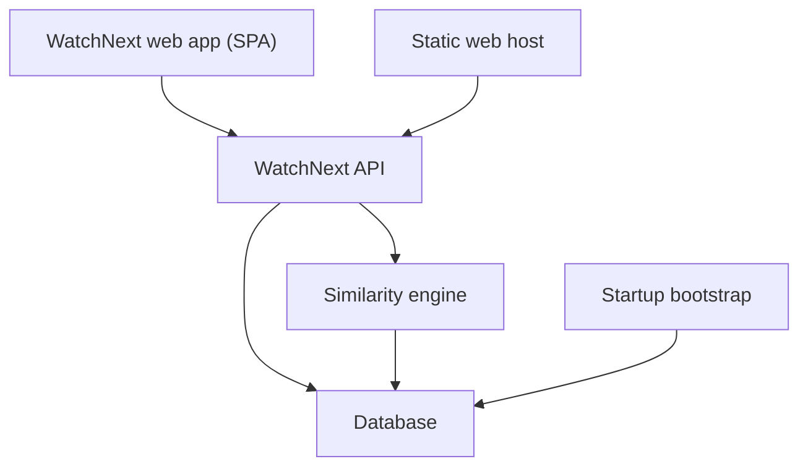
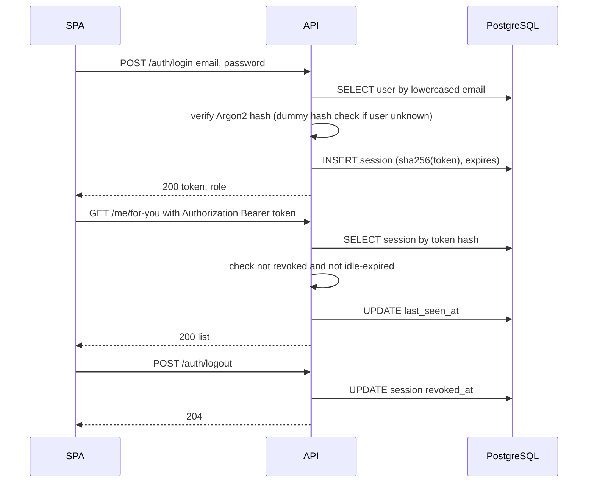
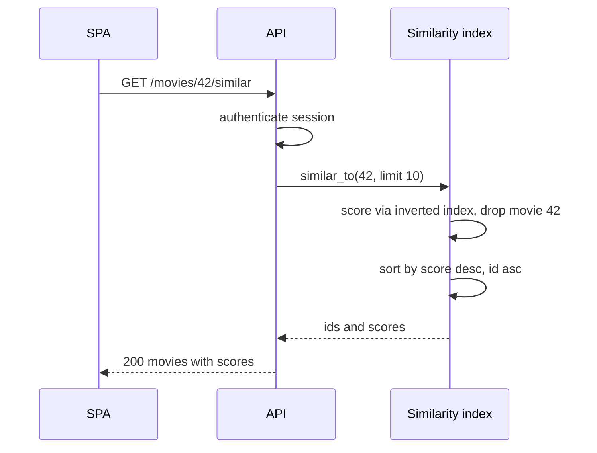
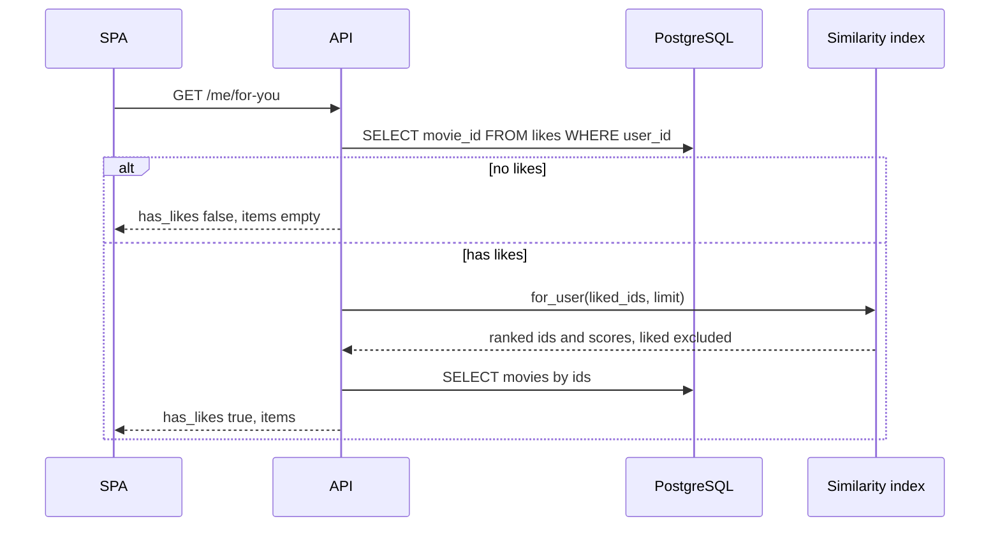
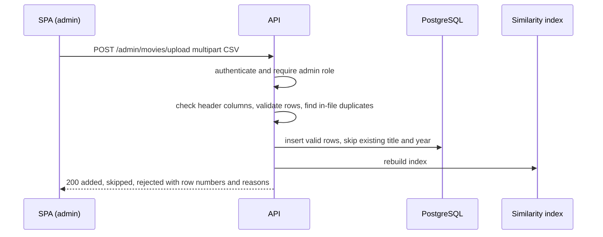
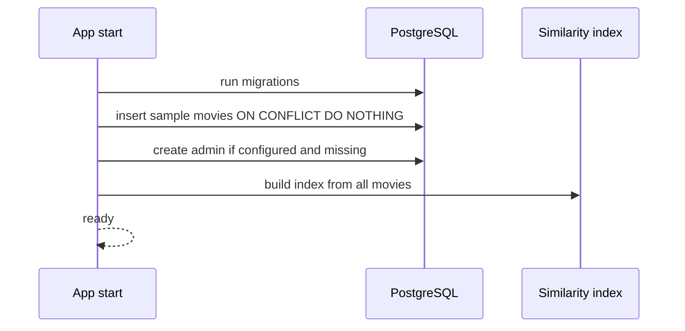
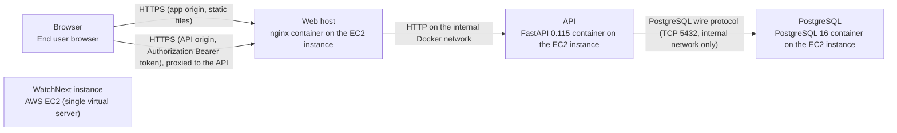

# Architecture

> Maintained by QuorQ AI SDLC. Text between `sdlc:auto` markers is regenerated; anything outside them is yours and is kept.

<!-- sdlc:auto:start narrative -->
## Overview

### ARCH-OVERVIEW · approved · source: architecture:summary

WatchNext is a self-contained movie recommender. A React 19 SPA and a FastAPI 0.115 JSON API run on one AWS EC2 instance with PostgreSQL 16. The app makes no outside calls.

- Architecture version 1, status approved.
- SPA and API are served from two different origins on the instance (two hostnames behind nginx).
- Sign-in uses server-side sessions with an opaque bearer token. No cookies are involved.
- Similarity is coded in-house: TF-IDF vectors over plot, genres, director and cast, with cosine similarity over an in-memory sparse index. The index is rebuilt after each CSV upload.
- Search, likes, the For you list and admin CSV upload sit on top of the similarity engine.
- About 50 hand-written sample movies and the first admin account are created idempotently at startup, from bundled data and environment variables.
- Placeholder artwork is generated deterministically in the browser as inline SVG, so no image or font is fetched from outside.

**Related:** ARCH-DEPLOY, ARCH-TECH-WEB

### ARCH-TECH-FRONTEND · approved · source: architecture:technology_decision:Frontend

Frontend: React 19, approved by the product owner. It builds to static files served by nginx on their own origin.

- Alternatives considered: Vue, Svelte.
- Rationale given: covers search, detail, like buttons, For you and the admin upload screen.
- Builds to static files served by nginx on their own origin.
- Uses system fonts and generated SVG artwork, so nothing is fetched from outside.

**Related:** ARCH-COMP-SPA

### ARCH-TECH-BACKEND · approved · source: architecture:technology_decision:Backend

Backend: FastAPI 0.115, approved by the product owner. It hosts the routers and the in-process TF-IDF and cosine engine.

- Alternatives considered: Django, Flask.
- Hosts the auth, movie, like and upload routers and the in-process TF-IDF and cosine engine.
- At about 5,000 movies the sparse index sits comfortably in memory.

**Related:** ARCH-COMP-API, ARCH-COMP-SIMILARITY

### ARCH-TECH-DATABASE · approved · source: architecture:technology_decision:Database

Database: PostgreSQL 16, approved by the product owner in place of the SQLite the stories assumed. It runs on the same instance and calls no outside service.

- Alternative considered: SQLite.
- Conflict between inputs: the stories assumed SQLite; the approved architecture decision is PostgreSQL 16. Both are recorded here.
- Stores users, sessions, movies and likes.
- Unique constraints make signup, seeding, uploads and likes idempotent.
- Array columns hold genres and cast.

**Related:** ARCH-COMP-DB, ARCH-DATA-MODEL

### ARCH-TECH-CLOUD · approved · source: architecture:technology_decision:Cloud

Cloud: AWS, approved by the product owner. One EC2 instance hosts nginx, the API and PostgreSQL.

- Alternative considered: any other VPS provider.
- Nothing else on AWS is needed at runtime, which keeps the app self-contained.

**Related:** ARCH-DEPLOY

### ARCH-TECH-WEB · approved · source: architecture:technology_decision:Web server

Web server: nginx. The platform requires the SPA and API on two separate origins, and the approved stack cannot provide that from one FastAPI process.

- Alternatives considered: Caddy, FastAPI StaticFiles.
- nginx serves the static build on one hostname and proxies the API hostname.
- Caddy was rejected because its automatic certificate issuance calls outside services.

**Related:** ARCH-COMP-WEB

### ARCH-COMP-SPA · approved · source: architecture:component:spa

The WatchNext web app is a React 19 single-page app. It holds every user-facing screen and talks to the API with a bearer token.

- Screens: signup, login, search, movie detail with like/unlike and similar movies, For you with the no-likes prompt, and admin CSV upload with a result report.
- Stores the session token and sends it as a Bearer header on every call.
- Draws deterministic placeholder artwork from the movie title as inline SVG.
- Uses system fonts only and no outside assets.

**Related:** ARCH-TECH-FRONTEND, ARCH-COMP-API

### ARCH-COMP-WEB · approved · source: architecture:component:web

nginx is the static web host. It serves the built SPA on the frontend origin and reverse-proxies the API origin to FastAPI.

- Serves the built SPA files on the frontend origin.
- Reverse-proxies the API origin to the FastAPI process on the same instance.
- Every asset comes from the build output, with no CDN.

**Related:** ARCH-TECH-WEB, ARCH-DEPLOY

### ARCH-COMP-API · approved · source: architecture:component:api

The WatchNext API (FastAPI 0.115) exposes the auth, movies, likes, for-you and admin upload routers. It enforces security rules on the server.

- Routers: auth, movies, likes, for-you, admin upload.
- Validates input.
- Hashes passwords. Issues, validates and revokes opaque session tokens with an inactivity timeout.
- Enforces viewer/admin roles on the server.
- Parses and validates CSV uploads with row-numbered errors.
- Allows CORS only from the SPA origin.

**Related:** ARCH-TECH-BACKEND, ARCH-ENDPOINTS-AUTH, ARCH-PATH-AUTH

### ARCH-COMP-SIMILARITY · approved · source: architecture:component:similarity

The similarity engine does in-house TF-IDF vectorisation and cosine similarity. It keeps an in-memory sparse index and answers similar-to-movie and combined-for-user queries.

- Vectorises plot, genres, director and cast.
- Keeps an in-memory sparse index: L2-normalised vectors plus an inverted index.
- Answers similar-to-movie and combined-for-user queries with deterministic ordering.
- Rebuilds the index after catalog changes.
- Listed as FastAPI 0.115, and runs in the API process (see the technology decision for Backend).

**Related:** ARCH-PATH-SIMILAR, ARCH-PATH-FORYOU

### ARCH-COMP-BOOTSTRAP · approved · source: architecture:component:bootstrap

The startup bootstrap prepares the database, sample catalog and first admin when the API starts.

- Runs migrations.
- Loads the bundled hand-written sample catalog if it is missing (idempotent).
- Creates the first admin from environment variables if configured and absent.
- Logs a clear message when admin credentials are not configured.

**Related:** ARCH-PATH-BOOTSTRAP

### ARCH-COMP-DB · approved · source: architecture:component:db

PostgreSQL 16 persists users, sessions, movies and likes. It enforces the key uniqueness rules.

- Persists users, sessions, movies and likes.
- Enforces uniqueness of email, of title plus year, and of one like per user and movie.

**Related:** ARCH-TECH-DATABASE, ARCH-DATA-MODEL

### ARCH-PATH-AUTH · approved · source: architecture:critical_path:Sign up, log in and authenticated requests

This path covers signup, login, authenticated requests and logout using hashed passwords and opaque, revocable session tokens with a sliding inactivity timeout.

- Signup creates a viewer. The role is never read from input.
- Signup stores an Argon2 password hash and returns a session token.
- Login verifies the credentials. Unknown email and wrong password return the same generic error.
- Only the SHA-256 hash of the token is stored.
- Each request looks up the session and rejects it if it is revoked or idle beyond SESSION_LIFETIME_MINUTES.
- Otherwise the request slides last_seen_at forward.
- Logout sets revoked_at.

**Related:** ARCH-COMP-API, ARCH-ENDPOINTS-AUTH, ARCH-DATA-MODEL

### ARCH-PATH-SIMILAR · approved · source: architecture:critical_path:Similar movies

Similar movies are ranked by cosine similarity of TF-IDF vectors built from four namespaced term groups.

- Term groups: plot words (lowercased, stopwords removed), genres, director, cast. Each group is namespaced.
- Applies sublinear tf, smoothed idf and L2 normalisation, so cosine similarity is a sparse dot product through the inverted index.
- The selected movie is excluded.
- Ties are broken by movie id ascending.
- Empty fields contribute no terms.

**Related:** ARCH-COMP-SIMILARITY, ARCH-ENDPOINTS-MOVIES

### ARCH-PATH-FORYOU · approved · source: architecture:critical_path:For you recommendations

The For you list scores all unliked movies against the average of the user's liked-movie vectors. It is computed on every request.

- Loads the user's liked movie ids.
- With no likes, the response is has_likes=false and an empty list, so the SPA shows the prompt.
- Otherwise it averages the liked movies' normalised vectors. This equals the mean cosine to all likes, so every like contributes.
- Scores all other movies through the inverted index and excludes already-liked movies.
- Sorts by score descending, then id ascending.
- Computed per request, so it always reflects the latest likes.

**Related:** ARCH-COMP-SIMILARITY, ARCH-ENDPOINTS-LIKES

### ARCH-PATH-UPLOAD · approved · source: architecture:critical_path:Admin CSV upload

Admins upload movies as a CSV file. The file is validated row by row, duplicates are skipped, valid rows are inserted in one transaction, and the index is rebuilt after commit.

- Admin-only endpoint.
- The header must contain title, year, genres, director, cast and plot. Otherwise the whole file is rejected.
- Per-row validation: non-empty title, plausible integer year (1888 to current year plus 5), non-empty plot.
- Genres and cast are split on '|'.
- Rows are skipped if the lowercased title plus year already exists in the DB or earlier in the file.
- Valid rows are inserted in one transaction.
- The response lists counts and each rejected or skipped row with its row number and reason.
- The similarity index is rebuilt after commit, so no restart is needed.

**Related:** ARCH-ENDPOINTS-ADMIN, ARCH-COMP-API, ARCH-COMP-SIMILARITY

### ARCH-PATH-BOOTSTRAP · approved · source: architecture:critical_path:Startup bootstrap

At startup the API migrates the database, seeds the sample catalog, creates the first admin if configured, and builds the similarity index.

- Step 1: run Alembic migrations.
- Step 2: load the bundled sample_movies.json (about 50 hand-written entries) using insert-if-missing keyed on title_key plus year.
- Step 3: create the admin from ADMIN_EMAIL and ADMIN_PASSWORD if set and no user with that email exists.
- If the admin variables are not set, log a clear message and continue.
- Step 4: build the similarity index.
- The API runs as one uvicorn worker so the in-memory index stays consistent.

**Related:** ARCH-COMP-BOOTSTRAP, ARCH-DEPLOY

### ARCH-DATA-MODEL · approved · source: architecture:entities

The data model has four entities: users, sessions, movies and likes. Uniqueness constraints make the key operations idempotent.

- users: id, email, password_hash, role, created_at.
- sessions: id, token_hash, user_id, created_at, last_seen_at, revoked_at.
- movies: id, title, title_key, year, genres, director, cast_members, plot, created_at.
- likes: user_id, movie_id, created_at.
- Constraints: unique email, unique title plus year, one like per user and movie.
- Genres and cast are held in PostgreSQL array columns.

**Related:** ARCH-COMP-DB, ARCH-TECH-DATABASE

### ARCH-ENDPOINTS-AUTH · approved · source: architecture:endpoints:health-and-auth

Health and authentication endpoints: liveness, signup, login, logout and current user.

- GET /health: liveness check for deployment.
- POST /auth/signup: creates a viewer account and signs in. The role is always viewer and any submitted role is ignored. Duplicate emails are refused in any letter case.
- POST /auth/login: verifies credentials and issues an opaque session token. A wrong password or unknown email returns the same generic 401 message.
- POST /auth/logout: revokes the current session on the server.
- GET /auth/me: returns the current user, or 401 if the session is missing, revoked or idle-expired.

**Related:** ARCH-PATH-AUTH, ARCH-COMP-API

### ARCH-ENDPOINTS-MOVIES · approved · source: architecture:endpoints:movies

Movie endpoints for search or browse, movie detail and similar movies.

- GET /movies: search by case-insensitive title substring. An empty q lists the catalog alphabetically with pagination for browsing. Each item carries a liked flag for the caller.
- GET /movies/{movie_id}: movie detail with the caller's like state.
- GET /movies/{movie_id}/similar: other movies ranked by cosine similarity (highest first, ties by id), excluding the movie itself.

**Related:** ARCH-PATH-SIMILAR

### ARCH-ENDPOINTS-LIKES · approved · source: architecture:endpoints:likes-and-for-you

Like, unlike, own-likes and For you endpoints. Like and unlike are idempotent.

- PUT /movies/{movie_id}/like: like a movie. Idempotent, so repeats leave a single like.
- DELETE /movies/{movie_id}/like: remove the caller's like. Idempotent.
- GET /me/likes: the caller's own liked movies only.
- GET /me/for-you: movies ranked by combined similarity to all of the caller's likes, excluding already-liked movies. With no likes, has_likes is false and items is empty.

**Related:** ARCH-PATH-FORYOU

### ARCH-ENDPOINTS-ADMIN · approved · source: architecture:endpoints:admin

The admin endpoint for CSV movie upload is restricted to admins.

- POST /admin/movies/upload: admin-only CSV upload.
- Header: title, year, genres, director, cast, plot. '|' separates genres and cast.
- A non-CSV file or missing columns is rejected and nothing is added.
- Duplicates (existing or in-file) are skipped and invalid rows are rejected.
- The similarity index is rebuilt after commit.

**Related:** ARCH-PATH-UPLOAD

### ARCH-DEPLOY · approved · source: architecture:deployment_nodes

All server parts run on a single AWS EC2 instance under Docker Compose with three containers: web, api and db. The browser loads the SPA from the web origin and calls the API origin.

- Browser (end user browser): loads the React 19 build from the web origin and calls the API origin.
- WatchNext instance (AWS EC2, single virtual server): Linux host running Docker Compose with three containers.
- Web host (nginx container): serves the React 19 build on the app hostname and proxies the API hostname to the API container.
- API (FastAPI 0.115 container): Python with uvicorn, one worker so the in-memory similarity index is consistent.
- PostgreSQL (PostgreSQL 16 container): data on a Docker volume backed by the instance's EBS disk.

**Related:** ARCH-COMP-WEB, ARCH-COMP-API, ARCH-COMP-DB, ARCH-TECH-CLOUD
<!-- sdlc:auto:end narrative -->

<!-- sdlc:auto:start building-blocks -->
## Building Block View

| ID | Name | Technology | Responsibility | Depends on |
|---|---|---|---|---|
| spa | WatchNext web app (SPA) | React 19 | Screens for signup, login, search, movie detail with like/unlike and similar movies, For you with the no-likes prompt, and admin CSV upload with a result report. Stores the session token and sends it as a Bearer header on every call. Draws deterministic placeholder artwork from the movie title as inline SVG. Uses system fonts only and no outside assets. | api |
| web | Static web host | nginx | Serves the built SPA files on the frontend origin and reverse-proxies the API origin to the FastAPI process on the same instance. Every asset comes from the build output, with no CDN. | api |
| api | WatchNext API | FastAPI 0.115 | Routers for auth, movies, likes, for-you and admin upload. Validates input. Hashes passwords and issues, validates and revokes opaque session tokens with an inactivity timeout. Enforces viewer/admin roles on the server. Parses and validates CSV uploads with row-numbered errors. Allows CORS only from the SPA origin. | db, similarity |
| similarity | Similarity engine | FastAPI 0.115 | In-house TF-IDF vectorisation over plot, genres, director and cast, plus cosine similarity. Keeps an in-memory sparse index (L2-normalised vectors plus an inverted index). Answers similar-to-movie and combined-for-user queries with deterministic ordering. Rebuilds the index after catalog changes. | db |
| bootstrap | Startup bootstrap | FastAPI 0.115 | On startup, runs migrations, loads the bundled hand-written sample catalog if missing (idempotent), and creates the first admin from environment variables if configured and absent. Logs a clear message when admin credentials are not configured. | db |
| db | Database | PostgreSQL 16 | Persists users, sessions, movies and likes. Enforces uniqueness of email, of title plus year, and of one like per user and movie. | — |

<!-- sdlc:auto:end building-blocks -->

<!-- sdlc:auto:start runtime -->
## Runtime View

### Sign up, log in and authenticated requests

Signup creates a viewer (the role is never read from input), stores an Argon2 hash and returns a session token. Login verifies the credentials and returns the same generic error for unknown email or wrong password. Only the SHA-256 hash of the token is stored. Each request looks up the session, rejects it if revoked or idle beyond SESSION_LIFETIME_MINUTES, and otherwise slides last_seen_at forward. Logout sets revoked_at.

- **Components:** spa, api, db
- **Modules:** app/routers/auth.py, app/security.py, app/deps.py
- **Key functions:** signup(email, password) -> token, login(email, password) -> token, hash_password(pw) / verify_password(pw, hash), issue_session(user_id) -> raw_token, get_current_user(authorization) -> User, require_admin(user) -> User, logout(token)

### Similar movies

Builds TF-IDF vectors from four namespaced term groups: plot words (lowercased, stopwords removed), genres, director and cast. Applies sublinear tf, smoothed idf and L2 normalisation, so cosine similarity is a sparse dot product through the inverted index. The selected movie is excluded and ties are broken by movie id ascending. Empty fields simply contribute no terms.

- **Components:** spa, api, similarity
- **Modules:** app/similarity/tokenize.py, app/similarity/tfidf.py, app/similarity/index.py, app/routers/movies.py
- **Key functions:** build_terms(movie) -> Counter, build_index(movies) -> SimilarityIndex, SimilarityIndex.similar_to(movie_id, limit=10) -> [(movie_id, score)], cosine(a, b) -> float in [0,1]

### For you recommendations

Loads the user's liked movie ids. With no likes, the response is has_likes=false and an empty list, so the SPA shows the prompt. Otherwise it averages the liked movies' normalised vectors (equal to the mean cosine to all likes, so every like contributes), scores all other movies through the inverted index, excludes already-liked movies, and sorts by score descending then id ascending. The result is computed per request, so it always reflects the latest likes.

- **Components:** spa, api, similarity, db
- **Modules:** app/routers/likes.py, app/similarity/index.py
- **Key functions:** like_movie(user_id, movie_id) (INSERT ON CONFLICT DO NOTHING), unlike_movie(user_id, movie_id), SimilarityIndex.for_user(liked_ids, limit=20) -> [(movie_id, score)]

### Admin CSV upload

Admin-only endpoint. Checks the header contains title, year, genres, director, cast and plot, otherwise rejects the whole file. Per row it validates a non-empty title, a plausible integer year (1888 to current year plus 5) and a non-empty plot. It splits genres and cast on '|' and skips rows whose lowercased title plus year already exists in the DB or earlier in the file. Valid rows are inserted in one transaction. The response lists counts and each rejected or skipped row with its row number and reason. The similarity index is rebuilt after commit, so no restart is needed.

- **Components:** spa, api, db, similarity
- **Modules:** app/routers/admin.py, app/csv_import.py, app/similarity/index.py
- **Key functions:** upload_movies(file, admin_user) -> UploadReport, parse_and_validate(csv_text) -> (valid_rows, row_issues), title_key(title) -> lowercased trimmed title, rebuild_index(session)

### Startup bootstrap

At start: run Alembic migrations, load the bundled sample_movies.json (about 50 hand-written entries) using insert-if-missing keyed on title_key plus year, then create the admin from ADMIN_EMAIL and ADMIN_PASSWORD if set and no user with that email exists. If they are not set, log a clear message and continue. Finally build the similarity index. The API runs as one uvicorn worker so the in-memory index stays consistent.

- **Components:** bootstrap, db, similarity
- **Modules:** app/main.py (lifespan), app/bootstrap.py, app/data/sample_movies.json
- **Key functions:** seed_sample_movies(session), ensure_first_admin(session, settings), build_index(movies)

<!-- sdlc:auto:end runtime -->

<!-- sdlc:auto:start deployment-view -->
## Deployment View

| Name | Service | Runtime | Scaling | Environment |
|---|---|---|---|---|
| Browser | End user browser | Loads the React 19 build from the web origin and calls the API origin | n/a | dev |
| WatchNext instance | AWS EC2 (single virtual server) | Linux host running Docker Compose with three containers: web, api and db | Single instance (sized for about 5,000 movies and hundreds of users) | dev |
| Web host | nginx container on the EC2 instance | Serves the React 19 build on the app hostname and proxies the API hostname to the API container | Single container | dev |
| API | FastAPI 0.115 container on the EC2 instance | Python with uvicorn, one worker so the in-memory similarity index is consistent | Single worker, vertical scaling only | dev |
| PostgreSQL | PostgreSQL 16 container on the EC2 instance | postgres 16 with data on a Docker volume backed by the instance's EBS disk | Single node | dev |

| Source | Target | Protocol |
|---|---|---|
| Browser | Web host | HTTPS (app origin, static files) |
| Browser | Web host | HTTPS (API origin, Authorization Bearer token), proxied to the API |
| Web host | API | HTTP on the internal Docker network |
| API | PostgreSQL | PostgreSQL wire protocol (TCP 5432, internal network only) |

<!-- sdlc:auto:end deployment-view -->

<!-- sdlc:auto:start decisions -->
## Architecture Decisions

| Layer | Choice | ADR |
|---|---|---|
| Frontend | React 19 | [ADR-0001](adr/frontend.md) |
| Backend | FastAPI 0.115 | [ADR-0002](adr/backend.md) |
| Database | PostgreSQL 16 | [ADR-0003](adr/database.md) |
| Cloud | AWS | [ADR-0004](adr/cloud.md) |
| Web server | nginx | [ADR-0005](adr/web-server.md) |
<!-- sdlc:auto:end decisions -->

<!-- sdlc:auto:start links -->
## Related Documents

- [Data Model](data-model.md)
- [API Specification](api/openapi.yaml)
- [Architecture Decision Records](adr/README.md)
<!-- sdlc:auto:end links -->
