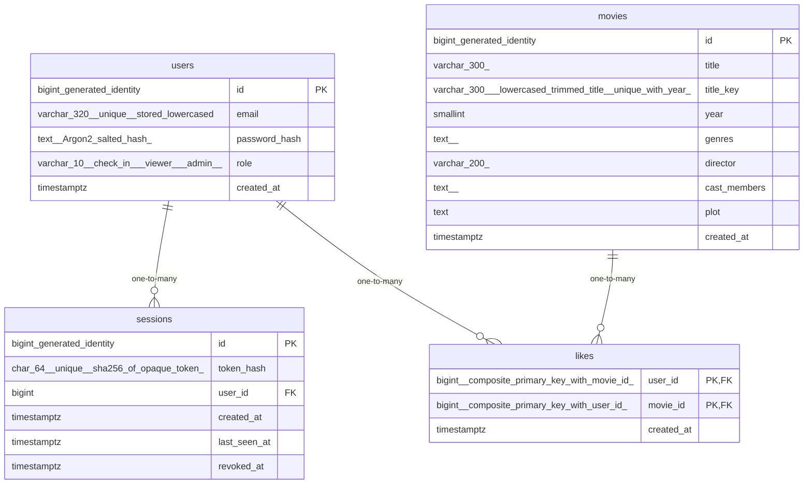

# Data Model

<!-- sdlc:auto:start entities -->
### users

| Field | Type | PK | FK | Nullable |
|---|---|---|---|---|
| id | bigint generated identity | True | — | False |
| email | varchar(320) unique, stored lowercased | False | — | False |
| password_hash | text (Argon2 salted hash) | False | — | False |
| role | varchar(10) check in ('viewer','admin') | False | — | False |
| created_at | timestamptz | False | — | False |

### sessions

| Field | Type | PK | FK | Nullable |
|---|---|---|---|---|
| id | bigint generated identity | True | — | False |
| token_hash | char(64) unique (sha256 of opaque token) | False | — | False |
| user_id | bigint | False | users.id | False |
| created_at | timestamptz | False | — | False |
| last_seen_at | timestamptz | False | — | False |
| revoked_at | timestamptz | False | — | True |

### movies

| Field | Type | PK | FK | Nullable |
|---|---|---|---|---|
| id | bigint generated identity | True | — | False |
| title | varchar(300) | False | — | False |
| title_key | varchar(300) (lowercased trimmed title, unique with year) | False | — | False |
| year | smallint | False | — | False |
| genres | text[] | False | — | False |
| director | varchar(200) | False | — | True |
| cast_members | text[] | False | — | False |
| plot | text | False | — | False |
| created_at | timestamptz | False | — | False |

### likes

| Field | Type | PK | FK | Nullable |
|---|---|---|---|---|
| user_id | bigint (composite primary key with movie_id) | True | users.id | False |
| movie_id | bigint (composite primary key with user_id) | True | movies.id | False |
| created_at | timestamptz | False | — | False |
<!-- sdlc:auto:end entities -->

<!-- sdlc:auto:start relationships -->
| Source | Target | Type |
|---|---|---|
| users | sessions | one-to-many |
| users | likes | one-to-many |
| movies | likes | one-to-many |
<!-- sdlc:auto:end relationships -->

<!-- sdlc:auto:start er-diagram -->

<!-- sdlc:auto:end er-diagram -->
