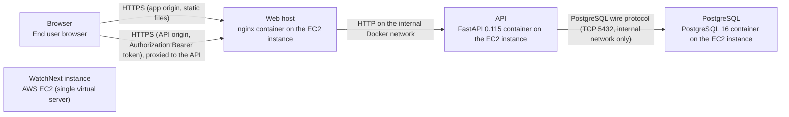

# Deployment Guide

> Maintained by QuorQ AI SDLC. Text between `sdlc:auto` markers is regenerated; anything outside them is yours and is kept.

<!-- sdlc:auto:start how-it-deploys -->
Pushes to `main` run `.github/workflows/deploy.yml`, which builds the API image (if there is a backend) and deploys the SPA to AWS Amplify. Commits touching only `docs/sdlc/**` don't deploy. Deployments can also be started from the platform's Deployment tab.
<!-- sdlc:auto:end how-it-deploys -->

<!-- sdlc:auto:start environments -->
| Name | Service | Runtime | Scaling | Environment |
|---|---|---|---|---|
| Browser | End user browser | Loads the React 19 build from the web origin and calls the API origin | n/a | dev |
| WatchNext instance | AWS EC2 (single virtual server) | Linux host running Docker Compose with three containers: web, api and db | Single instance (sized for about 5,000 movies and hundreds of users) | dev |
| Web host | nginx container on the EC2 instance | Serves the React 19 build on the app hostname and proxies the API hostname to the API container | Single container | dev |
| API | FastAPI 0.115 container on the EC2 instance | Python with uvicorn, one worker so the in-memory similarity index is consistent | Single worker, vertical scaling only | dev |
| PostgreSQL | PostgreSQL 16 container on the EC2 instance | postgres 16 with data on a Docker volume backed by the instance's EBS disk | Single node | dev |
<!-- sdlc:auto:end environments -->

<!-- sdlc:auto:start live -->
_Not deployed yet._
<!-- sdlc:auto:end live -->

<!-- sdlc:auto:start topology -->

<!-- sdlc:auto:end topology -->
